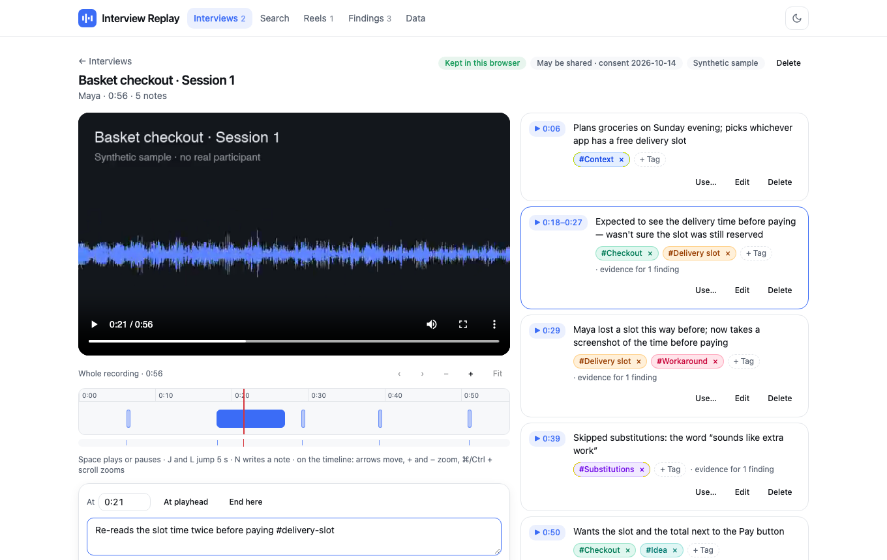

# Interview Replay

Review user-research interviews in the browser: replay a recording, note what you notice at the moment it happens, tag and search those moments across every interview, cut them into highlight reels, and back each finding with the moments that show it. Recordings and notes stay on your device.

**Live demo:** https://mrnednick.github.io/interview-replay/ — open “Try the sample study” for two annotated synthetic interviews.



## What it does

- **Import with consent.** Choose or drop an audio or video file (MP4, MOV, WebM, M4A, MP3, WAV…). The page reads its real length and a fingerprint, and won't import it until you record who the participant is, the date they agreed, and what they agreed to — review inside the team, or clips shared outside it. Importing the same file twice is refused and names the existing recording.
- **Notes on a timeline.** Notes are pinned to the moment you *started typing* — what you were reacting to — while the recording keeps playing; “End here” turns a note into a range, and the time can be typed. Every note is a mark on the timeline: an hour fits on screen, zooms down to seconds, and dense notes merge into one mark with a count. Space / J / L / N and the arrow keys work without the mouse.
- **Tags and search.** End a note with `#tags`, or tag it afterwards. Search every interview at once by words, “quoted phrases”, `#tags` or a participant's name — case and accents don't matter (“cafe” finds “Café”) — and jump straight to the moment. Spellings of one tag (“check-out” and “Checkout”) are offered for merging.
- **Highlight reels.** Collect moments from different interviews, reorder and trim them, and play them back to back — video and audio in one sequence. Clips whose file isn't available are skipped, not broken.
- **Findings with evidence.** State a finding and cite notes as evidence. Each cited moment plays in place; the finding shows whether it rests on one participant (an anecdote) or two or more (a pattern) — two sessions with the same person count once.
- **Export and deletion.** Download the whole study as one JSON file and open it in another browser, a Markdown findings report, or the notes as CSV. For readers outside the team, names become P1, P2… everywhere — in quotes, titles and captions — and moments from participants who agreed to team review only are left out and counted. When someone withdraws consent, one action deletes their recordings, stored files, notes, clips and citations, and takes their name out of the team's remaining text.

Try it without your own data: **Try the sample study** opens two short synthetic interviews about a grocery checkout (generated voices, no real participants) with nine notes, three findings and a reel. The [walkthrough](docs/walkthrough.md) goes through every scenario and lists how each was verified.

## Why React, the media element and IndexedDB

Interviews are the most personal data a product team handles, so the stack is the browser itself rather than a server:

- **Nothing is uploaded.** Files are read, measured and fingerprinted locally (`crypto.subtle`, SHA-256 over the size and both ends of the file, so a 2 GB recording is recognised instantly). The page works the same offline.
- **IndexedDB keeps the work.** The study and the media live in separate object stores: the study is a small document written on every change, the files are blobs written once. Removing a participant updates both in one transaction, so a deletion is never half done. Files can also be kept for one visit only — then the page asks for them again, and recognises the file by its fingerprint even after it was moved or renamed; a re-export of the same interview (same length, different bytes) is used only after asking.
- **The media element is the clock.** Its float seconds become whole milliseconds at one boundary; everything else — notes, clips, the timeline viewport, reel positions — is integer time in a pure domain.
- **React renders a pure domain.** Every rule is a plain function over immutable data in `src/domain`, returning the new study or a distinct error. The same functions run in unit tests, the sample builder and the page.

Measured on an hour-long interview with 3,000 notes (the test fixture): the whole-hour timeline turns 3,000 notes into 200 marks in 0.1 ms, finding the note under the playhead for every second of the hour takes 0.4 ms in total, a search across all notes 7 ms, and the study file (765 kB) is written in about 1 ms. The production bundle is 112 kB gzipped.

## How it is built

| Stage | Domain (`src/domain`) | Interface (`src/features`) |
|---|---|---|
| Import | `01-import.ts` — file checks, duration, consent, fingerprint ranges, matching a moved file | `01-import` — import dialog, library, sample study |
| Timeline and notes | `02-notes.ts` — notes, time parsing, viewport, zoom, marks, the current note | `02-review` — player, timeline, composer, note list, relinking a file |
| Tags and search | `03-tags.ts` — tag names, merging, similar spellings, query parsing, accent-free search with highlights | `03-search` — search page, tag manager |
| Reels | `04-reels.ts` — clips from notes, trimming, ordering, playback plan, consent | `04-reels` — reel player and editor |
| Findings | `05-findings.ts` — evidence, strength, ordering | `05-findings` — findings, evidence picker, moment player |
| Export and deletion | `06-export.ts` + `workspace.ts` — study file, versions, report, CSV, redaction, removal | `06-data` — data page |

`src/adapters` holds IndexedDB and the media probe; `src/app` the study context and the hash router. Interface primitives (buttons, fields, dialogs, toasts) come from a shared component registry.

Tests: 46 Vitest unit tests on the domain, including the hour-long fixture, and 14 Playwright scenarios run at 1440 px and 360 px against the production build — import and consent, a moved and a re-exported file, notes and the timeline from the keyboard, search and tag merging, reels across audio and video, findings, the study file in a second browser, the shareable report and deleting a participant. The browser runs muted.

## Study file contract

`exportStudy` writes `{ format: "interview-replay-study", version: 1, recordings, notes, tags, reels, findings }`. `readStudy` refuses other files, files from a newer version, repeated ids and anything malformed — a study is never half loaded. A study saved before a collection existed reads with that collection empty; references to deleted things are dropped and counted.

## Run

```sh
npm ci
npm run dev           # http://localhost:5173
npm test              # Vitest
npm run lint          # oxlint
npm run typecheck     # tsc -b
npm run build
npm run test:e2e      # Playwright on the production build, desktop and 360 px
npm run demo:package  # artifacts/interview-replay-demo.tar.gz: the build and the walkthrough
npm run samples       # rebuilds the sample interviews (macOS voices + ffmpeg)
```

Node 22 (see `.nvmrc`).
